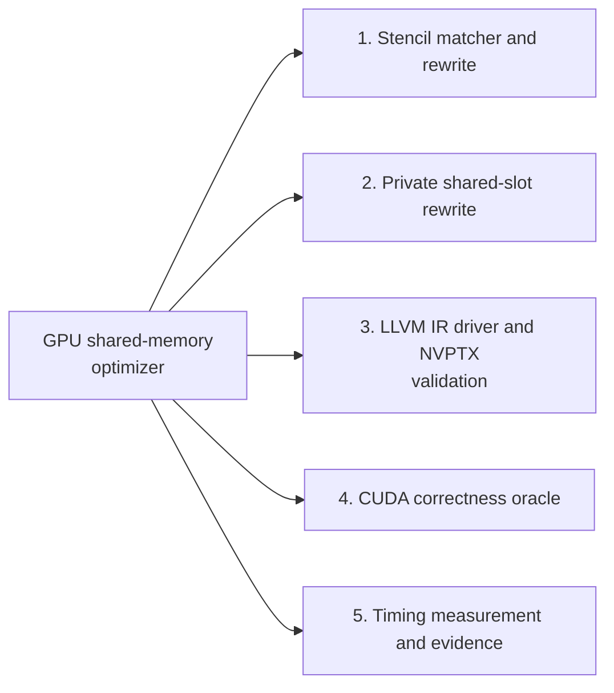
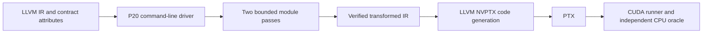
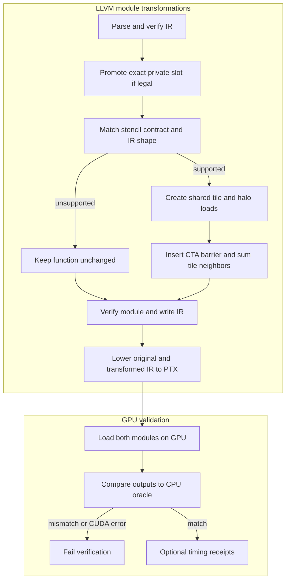

# GPU shared-memory optimizer

This project adds two bounded LLVM 23 module transformations to the full-history, MIT-licensed [`llvm-tutor`](https://github.com/banach-space/llvm-tutor) codebase. It is an educational, pattern-specific optimizer rather than a general GPU loop optimizer.

`StencilSharedCachePass` recognizes exact padded `i32` sums with fixed radii 1, 4, 8, or 16 (3, 9, 17, or 33 taps) in a 128-thread NVPTX kernel. It creates a cooperative address-space-3 tile of `128+2R` elements, loads R halos on each side, synchronizes the CTA, and reuses the lane's center SSA value plus shared neighbors. The matcher anchors scalar `i32` GEPs on the output index `zext i32(block*128+tid.x) to i64`, requires every offset exactly once and accesses aligned to at least four bytes, and leaves unsupported IR unchanged.

`PrivateSharedSlotPromotionPass` removes one same-lane store/load pair for a `[128 x i32]` address-space-3 slot in an exact 128-thread single-block kernel. It verifies the GEP type matches the slot global and preserves CTA barriers. It rejects cross-thread accesses and unsupported uses.

## Contents
- [Implementation techniques](#implementation-techniques)

- [Architecture and execution guide](#architecture-and-execution-guide)
- [Build and verify](#build-and-verify)
- [Contracts and evidence](#contracts-and-evidence)
- [Implementation record](reports/P20-implementation.md)
- [Verification driver](.agents/skills/verify-gpu-shared-memory-optimizer/SKILL.md)

## Architecture and execution guide

### Subsystem map

Select a subsystem in the diagram to open its techniques, tradeoffs, and code references. The numbered links provide the same navigation. This map groups components; the execution diagrams show their runtime flow.



1. [Stencil matcher and rewrite](#subsystem-stencil-matcher-and-rewrite)
2. [Private shared-slot rewrite](#subsystem-private-shared-slot-rewrite)
3. [LLVM IR driver and NVPTX validation](#subsystem-llvm-ir-driver-and-nvptx-validation)
4. [CUDA correctness oracle](#subsystem-cuda-correctness-oracle)
5. [Timing measurement and evidence](#subsystem-timing-measurement-and-evidence)

The project adds two conservative [LLVM IR passes](#llvm-ir-pass) to the inherited `llvm-tutor` codebase. LLVM provides parsing, verification, pass management, and NVPTX lowering. The additions recognize a fixed padded stencil sum and one lane-private shared slot; unsupported IR remains unchanged. GPU profiling is unavailable, so the timing evidence does not identify a hardware bottleneck.

<details>
<summary>Expand flow diagram 1</summary>



</details>

The driver owns the compilation journey from IR input through transformed IR. LLVM lowers the result through [NVPTX](#nvptx) to PTX; the CUDA Driver API runner loads original and transformed modules and compares their outputs with a CPU oracle. The P20 CPU workflow stops before GPU execution.

<details>
<summary>Expand flow diagram 2</summary>



</details>

The private-slot pass removes only one same-lane store/load pair with no intervening memory effect. The stencil pass requires its explicit shape contract, full 128-thread CTAs, padded `i32` input with a [halo](#halo), and exact offsets. Its generated tile uses NVPTX shared-memory [address space](#address-space). Unsupported shapes are retained; runtime buffers must also satisfy the caller contract in the verification guide.

| Subsystem | Responsibility and invariant | Source |
| --- | --- | --- |
| Pass driver | Parses and verifies input, runs both module passes, verifies output, then writes IR. | [`SharedMemoryMain.cpp`](tools/SharedMemoryMain.cpp) |
| Stencil matcher and rewrite | Recognizes radii 1, 4, 8, or 16 and emits a shared tile with halo loads and CTA synchronization. | [`StencilSharedCache.cpp`](lib/StencilSharedCache.cpp), [`StencilSharedCache.h`](include/StencilSharedCache.h) |
| Private-slot promotion | Removes one lane-indexed shared store/load pair only when uses and intervening effects meet the narrow contract. | [`PrivateSharedSlotPromotion.cpp`](lib/PrivateSharedSlotPromotion.cpp), [`PrivateSharedSlotPromotion.h`](include/PrivateSharedSlotPromotion.h) |
| CUDA runner | Loads both PTX modules, launches fixed 128-thread blocks, and compares results with modulo-`i32` CPU sums. | [`CudaRunner.cpp`](tools/CudaRunner.cpp) |
| Verification and evidence | Drives build, legality, NVPTX generation, GPU execution, and cleanup while preserving receipts. | [`verify.ps1`](tools/verify.ps1), [verification guide](.agents/skills/verify-gpu-shared-memory-optimizer/SKILL.md) |

The execution journey is:

1. Run the verifier's Launch and Doctor phases to build the pass and CUDA runner and confirm the local toolchain and GPU.
2. Feed LLVM IR with the matching `p20.stencil-contract` attribute or a supported private shared slot to the driver. It verifies input before running either pass.
3. The passes either rewrite the exact recognized shape or leave it unchanged. The driver verifies the result and writes transformed IR; LLVM then emits NVPTX.
4. The CUDA runner loads original and transformed PTX, executes both, and compares outputs against an independent CPU oracle. CUDA, parse, verifier, and oracle failures stop the run.
5. Evidence and benchmark phases retain receipts. Timings measure the documented launch or transaction path, not an isolated hardware bottleneck; profiling remains unavailable.

| Choice | Current implementation and rationale | Alternative and cost or reconsideration point |
| --- | --- | --- |
| Explicit shape contracts | Stencil optimization requires a recognized contract string and exact IR shape, limiting rewrites to verified patterns. | General affine analysis could cover more kernels but needs broader proofs and tests. |
| Shared tile with one halo per lane edge | A CTA cooperatively loads `128 + 2R` values, with lanes below radius loading the left halo and lanes at the upper edge loading the right. | Direct global loads are simpler and remain the untreated comparison; tile synchronization and shared traffic can cost more than they save. |
| Preserve center SSA value | Each lane reuses its center input instead of reloading it from shared memory. | Loading all neighbors uniformly simplifies the loop but adds a redundant shared read per output. |
| Conservative private-slot promotion | Only a single same-lane store/load pair with no intervening memory write or call is removed. | Broader alias reasoning may remove more traffic but raises legality risk. |
| Fixed 128-thread CTA and divisible length | The contract matches the generated indexing and avoids adding edge masks to each stencil access. | Tail handling would support arbitrary lengths but changes the transformation and caller requirements. |

These choices are inferred from code. Verification establishes correctness for the supported IR and local GPU cases, not general optimizer safety or a performance win. Results depend on radius, size, and timing scope; no overall full-transaction win is established. The center-reuse cleanup improved one same-slot comparison. Hardware counter profiling remains unavailable.

<a id="llvm-ir-pass"></a>

<details><summary>What is an LLVM IR pass?</summary>

An LLVM IR pass reads or changes LLVM's typed intermediate representation. These module passes inspect function bodies and either rewrite a recognized pattern or preserve the input function unchanged.

</details>

<a id="address-space"></a>

<details><summary>What is an address space?</summary>

An address space marks which memory region a pointer refers to in LLVM IR. The stencil pass requires global input/output pointers and creates its tile in NVPTX address space 3, the shared-memory region.

</details>

<a id="halo"></a>

<details><summary>What is a stencil halo?</summary>

A halo is the extra input around a block's output range needed by neighboring computations. For radius 4, each 128-output CTA needs four input values on both sides, so its tile has 136 entries.

</details>

<a id="cta-barrier"></a>

<details><summary>What is a CTA barrier?</summary>

A CTA barrier makes threads in one cooperative thread array wait until the group reaches the synchronization point. The transformed stencil waits at a CTA barrier after tile loads before reading neighbor lanes from shared memory.

</details>

<a id="lane-private-slot"></a>

<details><summary>What is a lane-private shared slot?</summary>

A lane-private shared slot is a shared-memory array entry used only by the thread whose lane index selects it. The promotion pass removes one store/load round trip only when the IR proves that the value cannot be changed between those operations.

</details>

<a id="nvptx"></a>

<details><summary>What is NVPTX?</summary>

NVPTX is LLVM's target representation for NVIDIA GPU code. The workflow lowers verified LLVM IR to PTX, then the CUDA Driver API loads that PTX for local execution.

</details>

<a id="build-and-verify"></a>

## Implementation techniques

This section covers the active P20 IR passes and the verification and measurement paths that exercise them. It excludes the inherited `llvm-tutor` examples outside those paths. The rationale is inferred from current code.

<details>
<summary>Full technique index</summary>

| Subsystem | Technique cards | Code |
| --- | --- | --- |
| Stencil matching and rewrite | [contract matching](#technique-p20-exact-match); [scalar address and index legality](#technique-p20-scalar-index-legality); [cooperative tile and halo ownership](#technique-p20-shared-tile); [center SSA reuse](#technique-p20-center-ssa-reuse) | [`StencilSharedCache.cpp`](lib/StencilSharedCache.cpp), [`StencilSharedCache.h`](include/StencilSharedCache.h) |
| Private shared-slot rewrite | [lane-private promotion with alias and effect checks](#technique-p20-private-promotion) | [`PrivateSharedSlotPromotion.cpp`](lib/PrivateSharedSlotPromotion.cpp), [`PrivateSharedSlotPromotion.h`](include/PrivateSharedSlotPromotion.h) |
| IR driver and NVPTX validation | [verify IR before and after transformation, then lower for NVPTX](#technique-p20-ir-nvptx-validation) | [`SharedMemoryMain.cpp`](tools/SharedMemoryMain.cpp), [`verify.ps1`](tools/verify.ps1), [`check-stencil.py`](tools/check-stencil.py) |
| CUDA correctness | [compare GPU results with the modulo-`i32` CPU oracle](#technique-p20-cpu-oracle) | [`CudaRunner.cpp`](tools/CudaRunner.cpp) |
| Timing and evidence | [separate resident launch batches from warm transactions](#technique-p20-timing-scopes) | [`CudaRunner.cpp`](tools/CudaRunner.cpp), [`benchmark-stencils.ps1`](tools/benchmark-stencils.ps1), [`summarize-stencils.py`](tools/summarize-stencils.py) |

</details>

<a id="subsystem-stencil-matcher-and-rewrite"></a>

### 1. Stencil matcher and rewrite

[Back to the subsystem map](#architecture-and-execution-guide).

**Code.** [`lib/StencilSharedCache.cpp`](lib/StencilSharedCache.cpp), [`include/StencilSharedCache.h`](include/StencilSharedCache.h).

**Techniques.** [Contract-gated exact IR matching](#technique-p20-exact-match), [Scalar address, index, and flag legality checks](#technique-p20-scalar-index-legality), [Cooperative shared-memory tiling with halo ownership](#technique-p20-shared-tile), [Center SSA reuse across the tile reads](#technique-p20-center-ssa-reuse).

**Related concepts.** [address space](#address-space), [CTA barrier](#cta-barrier).

<a id="technique-p20-exact-match"></a>

<details>
<summary>Contract-gated exact IR matching</summary>

**Mechanism.** The stencil pass first maps one of four exact contract strings to radius 1, 4, 8 or 16. It then checks a single-block PTX kernel, the 128-thread launch requirement, pointer address spaces and attributes, output index construction, aligned non-atomic `i32` loads, one exact offset per tap, and a matching sum tree. A failed check leaves the function unchanged.

**Example.** Radius 4 requires nine distinct input offsets from -4 through +4, all rooted at the output's `block*128+lane` index.

**Why here.** The rewrite's indexing and halo assumptions are safe only for a narrow recognized shape.

**Tradeoffs.** Equivalent IR written in another shape is rejected. Broadening the matcher requires proving and checking each new form.

**Code and ownership.** [`contractRadius`](lib/StencilSharedCache.cpp#L17) maps the four strings. [`isSupported`](lib/StencilSharedCache.cpp#L68) checks the kernel contract. This pass is a project extension.


**Used in.** [Stencil matcher and rewrite](#subsystem-stencil-matcher-and-rewrite). [Back to the subsystem map](#architecture-and-execution-guide).

</details>

<a id="technique-p20-scalar-index-legality"></a>

<details>
<summary>Scalar address, index, and flag legality checks</summary>

**Mechanism.** The stencil matcher anchors the output GEP at `zext i32(block*128+tid.x) to i64`. It accepts only one-index scalar `i32` GEPs, aligned non-atomic and nonvolatile loads and stores, and unflagged arithmetic. Each input address must be the base index or one unflagged `i64` add or subtract by an expected offset. The pass checks that each offset occurs once and that every load feeds the sum exactly once.

**Example.** For radius 4, the source addresses must cover `base-4` through `base+4`; computing a negative halo offset in `i32` before extending it to `i64` is rejected.

**Why here.** These checks keep indexing and modulo-`i32` behavior within the shape the rewrite constructs.

**Tradeoffs.** Equivalent address expressions outside the checked forms remain unchanged. The CPU legality checker exercises flagged arithmetic, byte GEPs, weak alignment, duplicate offsets, extra loads, and offsets built before the extension.

**Code and ownership.** [`isIndexOffset`](lib/StencilSharedCache.cpp#L41), [`isSupported`](lib/StencilSharedCache.cpp#L125), and [`variants`](tools/check-stencil.py#L17); project extension.


**Used in.** [Stencil matcher and rewrite](#subsystem-stencil-matcher-and-rewrite). [Back to the subsystem map](#architecture-and-execution-guide).

</details>

<a id="technique-p20-shared-tile"></a>

<details>
<summary>Cooperative shared-memory tiling with halo loads</summary>

**Mechanism.** The rewrite allocates a shared tile of `128 + 2R` integers. Each lane loads its center into `lane + R`; lanes below `R` load left halo values, and lanes at or above `128 - R` load right halo values. A CTA barrier follows the loads. Each lane sums neighboring tile entries, reusing its center SSA value, then stores its output.

**Example.** Radius 4 creates 136 slots for 128 centers and eight halo values.

**Why here.** The exact stencil reads adjacent input values that neighboring lanes have already loaded into the cooperative tile.

**Tradeoffs.** The pass adds branches, shared storage and a CTA barrier. The caller must provide padded input, full 128-thread CTAs and a length divisible by 128; the pass adds no tail masks.

The lane ranges are disjoint: every lane writes one center, lanes below `R` write the left halo, and lanes at or above `128-R` write the right halo. All paths reach the barrier before neighbor reads.

**Code and ownership.** [`StencilSharedCachePass::run`](lib/StencilSharedCache.cpp#L179), including tile ownership and the CTA barrier at [`L255`](lib/StencilSharedCache.cpp#L255); project extension.


**Used in.** [Stencil matcher and rewrite](#subsystem-stencil-matcher-and-rewrite). [Back to the subsystem map](#architecture-and-execution-guide).

</details>

<a id="technique-p20-center-ssa-reuse"></a>

<details>
<summary>Center SSA reuse across the tile reads</summary>

**Mechanism.** The generated kernel keeps the value returned by the center global load in an SSA value, stores that value into the tile, and starts the sum with the same SSA value after the CTA barrier. It loads only the nonzero-offset neighbors from shared memory. For the legacy radius-1 fixture, the verifier checks two shared neighbor loads per output path rather than reloading the center. The radius-aware checker expects 2R neighbor loads for radius R.

**Example.** `center = load input[base]`; `store tile[lane + R], center`; after the barrier, `sum = center` before adding tile neighbors.

**Why here.** The source stencil already loads the center from global memory, so the rewrite can use that value for the output sum.

**Tradeoffs.** This removes a redundant shared read in the generated form but does not establish a timing win for the complete tile transformation. The retained value and its live range are specific to this rewrite.

**Code and ownership.** [`StencilSharedCachePass::run`](lib/StencilSharedCache.cpp#L229) creates the center value and [`StencilSharedCachePass::run`](lib/StencilSharedCache.cpp#L256) uses it after the barrier. [`verify.ps1`](tools/verify.ps1#L141) checks shared-load count. Project extension.


**Used in.** [Stencil matcher and rewrite](#subsystem-stencil-matcher-and-rewrite). [Back to the subsystem map](#architecture-and-execution-guide).

</details>

<a id="subsystem-private-shared-slot-rewrite"></a>

### 2. Private shared-slot rewrite

[Back to the subsystem map](#architecture-and-execution-guide).

**Code.** [`lib/PrivateSharedSlotPromotion.cpp`](lib/PrivateSharedSlotPromotion.cpp), [`include/PrivateSharedSlotPromotion.h`](include/PrivateSharedSlotPromotion.h).

**Techniques.** [Promotion of a proven lane-private shared slot](#technique-p20-private-promotion).

**Related concepts.** [CTA barrier](#cta-barrier), [lane-private shared slot](#lane-private-slot).

<a id="technique-p20-private-promotion"></a>

<details>
<summary>Promotion of a proven lane-private shared slot</summary>

**Mechanism.** The pass recognizes a 128-element shared `i32` array indexed by the current lane, with exactly one store and one later load in a single-block 128-thread kernel. The global must have one matching array GEP, and that GEP must have only the store and load as users. The pass checks the GEP type, lane index, store-before-load order, and intervening memory effects. It rejects atomics, volatile accesses, writes and non-barrier calls. When checks pass, it replaces the load with the stored SSA value and removes the store and slot address.

**Example.** `shared[tid] = value; ... result = shared[tid]` can become `result = value` if no intervening memory effect can change the slot.

**Why here.** The transformation removes a redundant same-thread memory round trip when the IR proves the location is private to that lane.

**Tradeoffs.** The effect scan is conservative. Aliasing patterns and multi-block control flow are not promoted; CTA barriers are preserved.

**Code and ownership.** [`isLaneId`](lib/PrivateSharedSlotPromotion.cpp#L12) and [`PrivateSharedSlotPromotionPass::run`](lib/PrivateSharedSlotPromotion.cpp#L38); project extension.


**Used in.** [Private shared-slot rewrite](#subsystem-private-shared-slot-rewrite). [Back to the subsystem map](#architecture-and-execution-guide).

</details>

<a id="subsystem-llvm-ir-driver-and-nvptx-validation"></a>

### 3. LLVM IR driver and NVPTX validation

[Back to the subsystem map](#architecture-and-execution-guide).

**Code.** [`tools/SharedMemoryMain.cpp`](tools/SharedMemoryMain.cpp), [`tools/verify.ps1`](tools/verify.ps1), [`tools/check-stencil.py`](tools/check-stencil.py).

**Techniques.** [LLVM IR verification and NVPTX lowering checks](#technique-p20-ir-nvptx-validation).

**Related concepts.** [address space](#address-space), [NVPTX](#nvptx).

<a id="technique-p20-ir-nvptx-validation"></a>

<details>
<summary>LLVM IR verification and NVPTX lowering checks</summary>

**Mechanism.** The CLI parses input LLVM IR, verifies the module, runs private-slot promotion before stencil rewriting, verifies the result, and writes it. The maintained verifier checks both original and transformed modules, lowers both with LLVM `llc` for `nvptx64` and `sm_120`, then checks the PTX memory instructions and barrier against the expected transform shape. The CPU-only checker also verifies that rejected cases remain unchanged after canonicalization.

**Example.** `shared-memory-opt input.ll -o output.ll` must produce verifier-valid IR; `llc -march=nvptx64 -mcpu=sm_120 output.ll` must emit PTX before native GPU validation can run.

**Why here.** LLVM verification catches malformed IR, and target lowering checks that the changed address spaces and barrier are accepted by the project’s pinned backend.

**Tradeoffs.** LLVM and NVPTX checks establish IR validity and code-generation compatibility, not GPU execution correctness or performance.

**Code and ownership.** [`main`](tools/SharedMemoryMain.cpp#L25), the verifier's IR/PTX checks in [`verify.ps1`](tools/verify.ps1#L121), and [`main`](tools/check-stencil.py#L64). The pass and validation driver are project extensions; LLVM verifier and NVPTX lowering are inherited dependencies.


**Used in.** [LLVM IR driver and NVPTX validation](#subsystem-llvm-ir-driver-and-nvptx-validation). [Back to the subsystem map](#architecture-and-execution-guide).

</details>

<a id="subsystem-cuda-correctness-oracle"></a>

### 4. CUDA correctness oracle

[Back to the subsystem map](#architecture-and-execution-guide).

**Code.** [`tools/CudaRunner.cpp`](tools/CudaRunner.cpp), [`test/Inputs/P20StencilR4.ll`](test/Inputs/P20StencilR4.ll), [`test/Inputs/P20PrivateSlot.ll`](test/Inputs/P20PrivateSlot.ll).

**Techniques.** [Independent modulo-i32 CPU oracle comparison](#technique-p20-cpu-oracle).

<a id="technique-p20-cpu-oracle"></a>

<details>
<summary>Independent modulo-i32 CPU oracle comparison</summary>

**Mechanism.** The CUDA runner computes each expected output on the CPU by summing the `2R+1` input words in `uint32_t`, which gives the same modulo-`2^32` result as the unflagged LLVM `i32` sum. It runs original and transformed PTX on the same generated data, poisons output buffers before correctness launches, and compares each result with the CPU vector. Patterns include ordinary values, deterministic full-bit values, and distinct halo values with wraparound.

**Example.** For radius 1, `0xffffffff + 2 + 0x80000000` wraps to `0x80000001`; the runner self-checks this case.

**Why here.** The oracle checks semantics independently of the optimizer and compares both kernel versions, including halo and overflow cases.

**Tradeoffs.** It checks the finite launch sizes and patterns chosen by the runner. It does not prove correctness for arbitrary IR, geometry, or input allocation.

**Code and ownership.** [`oracle`](tools/CudaRunner.cpp#L27), [`selfTest`](tools/CudaRunner.cpp#L60), and [`runCase`](tools/CudaRunner.cpp#L132); project extension.


**Used in.** [CUDA correctness oracle](#subsystem-cuda-correctness-oracle). [Back to the subsystem map](#architecture-and-execution-guide).

</details>

<a id="subsystem-timing-measurement-and-evidence"></a>

### 5. Timing measurement and evidence

[Back to the subsystem map](#architecture-and-execution-guide).

**Code.** [`tools/CudaRunner.cpp`](tools/CudaRunner.cpp), [`tools/benchmark-stencils.ps1`](tools/benchmark-stencils.ps1), [`tools/summarize-stencils.py`](tools/summarize-stencils.py), [`docs/evidence/p20/stencil-radius-20261024/README.md`](docs/evidence/p20/stencil-radius-20261024/README.md).

**Techniques.** [Separate resident launch batches from warm transactions](#technique-p20-timing-scopes).

<a id="technique-p20-timing-scopes"></a>

<details>
<summary>Separate resident launch batches from warm transactions</summary>

**Mechanism.** The runner reports CUDA-event time for 64 launches that reuse device arrays. Separately, it times a warm-context transaction that allocates input and output, copies input to the device, poisons output, launches once, synchronizes, copies output back, and frees the buffers. Seven alternating original/transformed rounds reduce side-order bias; each timed output is checked against the CPU oracle. Context setup and module loading sit outside the transaction timer.

**Example.** The event sample describes repeated work on resident arrays. The transaction sample includes allocation and host-device transfers for one launch.

**Why here.** Reporting both scopes exposes whether a resident launch result also appears in the documented application transaction.

**Tradeoffs.** Event batches can include host-submission gaps; transaction timing still excludes context setup, module loading, JIT and oracle work. The observed samples do not identify a hardware bottleneck or establish a general performance gain. Profiling evidence remains unavailable.

**Code and ownership.** [`measure`](tools/CudaRunner.cpp#L114), [`transaction`](tools/CudaRunner.cpp#L149), the campaign's [`Prepare` manifest](tools/benchmark-stencils.ps1#L17), and [`parse`](tools/summarize-stencils.py#L14); project extension.


**Used in.** [Timing measurement and evidence](#subsystem-timing-measurement-and-evidence). [Back to the subsystem map](#architecture-and-execution-guide).

</details>

## Build and verify

On the configured Windows development machine, run the maintained product verifier from PowerShell 7 (`pwsh`):

```powershell
.\tools\verify.ps1 Launch
.\tools\verify.ps1 Doctor
.\tools\verify.ps1 Drive
.\tools\verify.ps1 Evidence
.\tools\verify.ps1 Cleanup
```

This builds the LLVM IR CLI and CUDA Driver API runner, verifies original and transformed IR, emits NVPTX, checks unsupported cases, and runs both kernels on the locally installed GPU against CPU oracles. See the [verification driver instructions](.agents/skills/verify-gpu-shared-memory-optimizer/SKILL.md) for prerequisites and evidence handling.

The [P20 CPU-only CI workflow](.github/workflows/p20-cpu-llvm23.yml) uses the SHA-256-pinned [official LLVM 23.1.4 release SDK](https://github.com/llvm/llvm-project/releases/tag/llvmorg-23.1.4), builds the optimizer, verifies the IR transformations and generates NVPTX. It does not run a GPU and provides no GPU-execution or performance claim. The earlier apt snapshot pin disappeared when that repository advanced to 23.1.5; the release archive preserves the required version.

The Linux build, IR checks, unsupported byte-GEP cases and NVPTX lowering passed in [run 39716593312](https://github.com/STEVVVU/gpu-shared-memory-optimizer/actions/runs/39716593312). GPU execution was checked separately on the local RTX 5080 Laptop GPU.

## Contracts and evidence

The coordinated Release-host RTX 5080 Laptop campaign ran on 22 October 2026 with CUDA 13.0.88, driver 592.01 and LLVM 23.1.4. The host runner uses `nvcc -O2` and device PTX uses `llc -O3`. Seven alternating samples of 64 launches per side use resident arrays and independently checked outputs. Stencil event times below are per-launch microseconds, with the median and full sample range.

| Output elements | Untreated | Shared tile with center reuse |
| --- | --- | --- |
| 16,384 | 6.44 [6.342,7.4655] | 6.488 [6.1915,8.1865] |
| 524,288 | 8.1215 [6.9365,14.484] | 8.2985 [7.686,12.536] |
| 4,194,304 | 19.9 [18.7135,23.522] | 22.9005 [22.7395,24.647] |
| 16,777,216 | 173.248 [172.861,257.307] | 182.23 [174.097,257.228] |

The shared-tile median is slower at every size, and its full ranges overlap untreated PTX. Inspection found a redundant reload of the lane's center from shared memory. Reusing its dominating SSA value removes one of three shared reads while preserving the center store, neighbor stores and CTA barrier. In a separate, same-slot old-versus-new PTX comparison through the same Release host, the 4M case improves from 24.7775 [24.7365,24.854] to 22.7785 [22.724,22.842] µs, about 8.1%, with nonoverlapping ranges. The other three cleanup comparisons overlap. This scoped cleanup gain does not overcome the transform's cost relative to untreated PTX; the tile transform has no demonstrated overall performance advantage. It remains opt-in through its explicit IR contract.

The [Release-host measurements](docs/evidence/p20/metrics-release-summary.json) retain all seven samples and raw-log SHA256 hashes for both stencil and private-slot paths, the runner/source hashes and build flags, plus the matched old/new experiment. Earlier unconfirmed-isolation runs are diagnostic. The [earlier clean campaign](docs/evidence/p20/metrics-summary.json) remains preserved with its original host-build limitation. Maximum input/output GPU payload is 128 MiB. Both stencil variants report 100% theoretical occupancy, rather than achieved occupancy. Timings exclude JIT, allocation, input copy and oracle readback. Effective bandwidth counts logical input and output bytes rather than DRAM traffic. Hardware counter profiling was unavailable; instruction counts do not establish a hardware bottleneck.

Event intervals around batches of launches can include gaps from host submission even with Release host code. They characterize this launch path and do not isolate hardware throughput. Rebuilding the host with `-O2` and rerunning the identical frozen inputs did not establish an optimizer win; no gain is claimed from a cross-campaign timing change.

Reproduce with `tools/benchmark.ps1 Prepare`, `Smoke`, and `Measure` after building the current tools. Retain the first PTX and logs before rebuilding a candidate, then compare the two optimized PTX files with `build/bin/cuda-runner.exe old.ptx new.ptx stencil --benchmark`. Run `python tools/summarize-benchmark.py` to validate and curate both campaigns. Run only in an exclusive GPU slot.

The stencil caller must launch a one-dimensional grid of full `(128,1,1)` CTAs for positive output length N divisible by 128 and `N-1 <= UINT32_MAX`. Input and output must be separate four-byte-aligned arrays; the interior input pointer has R valid halo elements in both directions within the same allocation. The exact contracts and bounded IR shapes are in the [stencil feature map](.agents/skills/verify-gpu-shared-memory-optimizer/features/stencil-tile.md). The pass does not add bounds checks or create a host launcher. Full scope, source provenance, verification results, and limitations are documented in the [P20 implementation record](reports/P20-implementation.md).

The fixed-radius 1/4/8/16 extension passed 132 CPU legality cases, LLVM verification, sm_120 PTX generation and native RTX 5080 oracle checks at 1, 3 and 17 CTAs. Two separate seven-repeat campaigns measured resident CUDA-event batches and full warm transactions at all 16 radius/size combinations. Radius 16 at 16,777,216 elements had transformed event medians of 341.648 and 337.615 microseconds, but full transaction ranges overlap the baseline and several other event cases are slower; no overall win is established. Hardware profiling remains blocked by a profiler driver-load failure after counter access was enabled. See the [full campaign report and receipts](docs/evidence/p20/stencil-radius-20261024/README.md). The CPU workflow checks the extension separately. No autotuner is included.

Curated LLVM IR, NVPTX, a local GPU result JSON file, and a valid `align 1` byte-GEP red reproduction are in [`docs/evidence/p20/`](docs/evidence/p20/). The GPU result is a local RTX 5080 Laptop GPU observation; timing results are measurements from one machine and are not general speedup claims. The CMU gallery confirms the project topic, but its linked final report was inaccessible; this implementation does not claim to reproduce that report.

The untouched upstream README is preserved as [`README.upstream.md`](README.upstream.md), and inherited workflows are retained outside the active workflow directory under [`docs/archive/upstream-workflows/`](docs/archive/upstream-workflows/).
